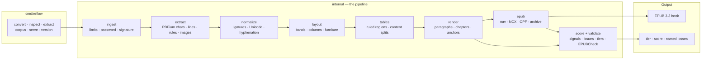
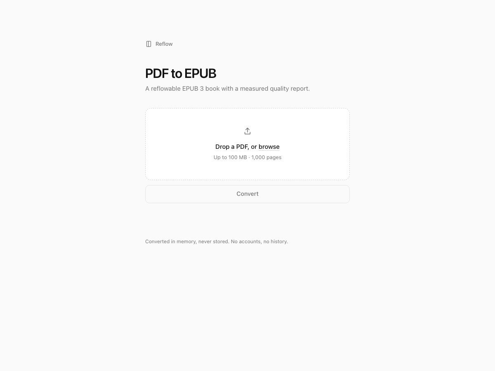

# Reflow

**A PDF → EPUB converter that measures itself.** A PDF stores positioned glyphs, not a document,
so "reflow" is inference with no single correct answer. Reflow's rule is that it never hands over
a book it has not measured: every conversion carries a fidelity tier, a score, and a list of the
things it lost. A book that fails EPUBCheck is refused rather than written.

It is built and calibrated against five real books — a 299-page technical book, a 233-page slide
deck, a 250-page novel, a CV and an invoice — and two of those are transcribed to ground truth:
**100.0% character recall on the invoice and 0.0% word error rate on the CV**.

---

## Contents

1. [What it does](#what-it-does)
2. [The result](#the-result)
3. [Architecture](#architecture)
4. [How a conversion works](#how-a-conversion-works)
5. [Reading order is decided per band](#reading-order-is-decided-per-band)
6. [Tables are recovered, or named as lost](#tables-are-recovered-or-named-as-lost)
7. [Measuring quality](#measuring-quality)
8. [What it refuses](#what-it-refuses)
9. [Install](#install)
10. [CLI](#cli)
11. [The web app](#the-web-app)
12. [Repository layout](#repository-layout)
13. [Configuration](#configuration)
14. [Verifying a build](#verifying-a-build)
15. [Troubleshooting](#troubleshooting)
16. [Known limits](#known-limits)
17. [Licence](#licence)

---

## What it does

One command turns a PDF into an EPUB 3 book that a reader app can reflow:

```sh
reflow convert book.pdf -o book.epub
```

What comes out:

- **Chapters from the PDF's own outline**, and a nested table of contents that keeps the
  document's real depth — the technical book's 109 outline entries become 109 navigation entries
  three levels deep, not 16 flat chapters.
- **Real tables** where the producer ruled them: an invoice's main grid comes back as rows and
  cells, not as a column of loose words.
- **Running headers and footers removed** (268 of them from one book), page numbers masked so the
  repeated edge is recognised rather than guessed.
- **Footnotes kept as footnotes**: a marked, small-type paragraph at the foot of a page becomes an
  EPUB `footnote` aside, linked to its reference when a raised marker in the text matches it.
- **Superscripts stay superscripts** — footnote markers and ordinal suffixes keep their raised
  type instead of arriving as inline digits.
- **A print page list**, so "go to page 42" still works in a reflowed book.
- **Figures embedded** — JPEG, PNG, grayscale and CMYK — and page breaks marked with EPUB
  `pagebreak` semantics.
- **An accessibility contract the writer enforces**: a document language is required, navigation
  landmarks are always emitted, and an image without `alt` is rejected. `alt=""` is allowed for
  decoration, because that is what empty alt means.
- **A verdict**: tier, score out of 100, and every loss by name.

No OCR is invented, no layout is preserved, and no DRM is touched. Encrypted files are opened
with the password the reader already has; a password Reflow cannot use is an error, not a bypass.

---

## The result

A conversion of the 299-page technical book, verbatim:

```text
299 pages, 14547 blocks, 16 chapters
epubcheck: 0 errors, 0 warnings
  WARN: 3 pages had no extractable text, so any images on them are missing.
  WARN: Skipped 9 images in a format EPUB cannot embed.
  INFO: Removed 268 running headers and footers.
  INFO: Chapters follow the PDF's own outline (109 entries).
  INFO: Recovered 5 ruled tables as real grids.
wrote book.epub (299 pages, 16 chapters, T2 84/100)
```

The two warnings are the point: 12 things the reader will not get are named, and the 84/100 is the
measured cost. A converter that printed "done" here would be lying.

The table of contents it wrote (excerpt):

```text
3 Implementing an attention mechanism from scratch
  3.4 Implementing self-attention with trainable weights
    3.4.1 A simplified self-attention mechanism
    3.4.2 Implementing a compact self-attention Python class
  3.5 Hiding future words with causal attention
    3.5.1 Applying a causal attention mask
```

What a book carries:

| Element | How it is produced |
|---|---|
| Chapters | The outline entry level that describes the document, located by position or by matching its title in the text |
| Sections | Outline entries below chapter level become anchors inside the chapter file and nested `<ol>`/`navPoint` entries |
| Page list | One anchor per printed page, wherever the page begins |
| Tables | Ruled regions, or a ruled region split at its content change; cells rebuilt from words |
| Figures | Embedded once per unique image, referenced from every place it appears |
| Cover | The first page-sized figure near the front — including a cover whose title was read off the artwork by OCR — declared as the cover image |
| Footnotes | A marked, small-type paragraph at the foot of a page becomes an `aside epub:type="footnote"`; its reference is a link when a raised marker on the same page matches |
| Running heads | Detected by masked repetition across pages, removed from the text |
| Metadata | Title, authors, language, publisher, and a content-derived identifier |

---

## Architecture



The CLI and the web app drive the same `internal/convert` pipeline; nothing is duplicated for the
server. PDFium is the only native dependency, reached through CGO and pkg-config. The original
design and the alternatives that were rejected are in [PROPOSAL.md](PROPOSAL.md).

---

## How a conversion works

| Stage | Package | What it does | The failure it prevents |
|---|---|---|---|
| Ingest | `ingest` | Signature check, byte and page limits, encryption probe, metadata | Renamed archives and 10,000-page uploads reaching the parser |
| Extract | `extract` | Chars with boxes, lines, drawn rules, images, OCR for pages with no text | Trusting a text order that is really drawing order |
| Normalize | `normalize` | Ligatures, Unicode forms, soft hyphens, control characters | "fi" reaching the reader as a glyph that will not select |
| Layout | `layout` | Reading order and running headers | Two columns read as one interleaved column |
| Tables | `tables` | Ruled regions to grids, content split when the rule is missing | A table flattened into a column of stray words |
| Render | `render` | Paragraphs, chapters, footnotes, inline superscripts, section and page anchors | Structure lost between extraction and the EPUB |
| Assemble | `epub` | Container, OPF, nav, NCX, accessibility metadata, archive | A book a reader opens to a blank page |
| Judge | `score`, `validate` | Tiers, score, issues, EPUBCheck | A book that validates nowhere but ships anyway |

Every stage is a library call with its own tests, which is why the corpus can convert a 300-page
book inside a unit-test budget.

---

## Reading order is decided per band

The hard part is not finding words; it is knowing what order a reader would say them in. A page
mixes structures — an invoice carries a two-column header over a one-grid table over paired
totals — and the classic "find the gutter" pass sees their union, which is neither structure.

So the page is cut into **horizontal bands** at its clear vertical gaps. Lines gap by single
digits; structures gap in the high teens and above. Within a band, the shape decides:

| Band shape | Reading |
|---|---|
| No gutter | Lines top-down, left to right within a line |
| Ragged columns (one side runs longer) | Left column whole, then right |
| Paired cells floating off the page's text margin | Row by row, so each label keeps its value |
| A narrow strip beside a column | After the column's margin-aligned header, before its indented body |

Each row exists because a real book failed without it:

- The invoice header's address runs six lines against a two-line date block, so the band is
  ragged and reads column-wise. The date keeps its value.
- The invoice's totals float at the table's amount column, paired label/value on the same lines —
  row-wise, so `Sub Total` sits beside `LKR 15,000.00`.
- A CV's dates sit in a narrow right strip beside an entry whose duties are indented below the
  employer. The strip annotates the header, so it reads after the employer and before the duties —
  not after every duty.
- Two short prose columns at the page's margin are still columns, however short their lines.

Measured against transcribed truth, that took the invoice from 8.2% to **0.7%** word error rate
(one word: the producer's own text layer says "Deployement") and the CV from 15.6% to **0.0%**.

The limits are honest, and in the README's last section: a perfectly balanced narrow pair with no
margin context is ambiguous, and a label/value grid anchored at the margin would read column-wise.

---

## Tables are recovered, or named as lost

A ruled table is the honest case: the producer drew the grid, so the structure is in the file.
Rows come from the horizontal rules and from clustered baselines; columns from the vertical edges
and word extents; each word lands in exactly one cell.

The interesting parts are the refusals:

- A ruled box that also holds prose (the invoice's frame carries an address above the table) is a
  layout box, not a table — rows that fill only one column reject it.
- A ruled region with no rule between its prose and its table is split where the content changes:
  a run of three or more multi-column rows below single-column rows.
- A wrapped title above a centred byline is not a 2×2 table. Each row must cluster into two or
  more columns by itself, or the "table" would eat the slide's title.
- A producer can rule one row as its own band (the invoice's 6 November row). Bands that are
  adjacent, share their x extent, and have words in the gap are one region.

When a table is *not* recovered, the verdict says so — `Flattened 1 table into running text; the
column layout is lost` — and it costs points.

---

## Measuring quality

Accuracy is measured two ways, and the difference matters.

**Synthetic corpus** (runs in CI): every failure mode has a generated PDF and the exact text it
should produce — columns, headings, running heads, a spaced heading, a scan. Six cases must pass
under `make check`.

**Real books** (local, because real PDFs cannot be committed): drop a PDF into `corpus/private/`
and, for truth, a `.txt` transcribed from the visible page. An optional `.expect.json` states what
"correct" means for that document — order markers, chapter titles, and tolerances. A form has no
single linear word order across its columns; it says so, and the metrics are still printed in
full, so a loosened threshold hides nothing.

The five books, as they scored on the day this was written:

| Book | Pages | Chapters | Tier / score | Truth |
|---|---|---|---|---|
| Technical book | 299 | 16 (109 TOC entries, depth 3) | T2 84/100 | reference only |
| Slide deck | 233 | 122 | T1 100/100 | reference only |
| Novel | 250 | 18 | T1 98/100 | reference only |
| CV | 2 | 7 | T1 98/100 | **99.9% recall, 0.0% WER** |
| Invoice | 2 | 1 | T1 95/100 | **100.0% recall, 0.7% WER** |

```text
case                                   recall  wer   order  chapters  result
Build-a-large-language-models          —       —     —      16        pass
Devops+For+Developers+-+Class+Notes    —       —     —      122       pass
Harry Potter and the Sorcerer's Stone  —       —     —      18        pass
Invoice 2                              100.0%  0.7%  yes    1         pass
kusal_kalinga                          99.9%   0.0%  yes    7         pass
5 cases, 0 failed
```

EPUBCheck runs on every conversion in the pipeline and again in CI; **zero errors is the gate**,
and the writer's own contracts — `mimetype` first and stored with no extra field, an OPF that lists
every archive member, nav landmarks — are unit-tested rather than assumed.

Tiers mean exactly what they say:

| Tier | Meaning |
|---|---|
| **T1 Structured** | Chapters and headings were detected |
| **T2 Reflowed** | Clean text, uncertain structure |
| **T3 Facsimile** | Reserved for the page-image path, which does not exist yet |

The score is auditable: every deduction is one of a handful of named signals (blank pages, no
headings, generic chapter titles, low-confidence blocks, flattened tables, dropped figures,
skipped images), and the report carries the numbers behind it.

---

## What it refuses

| Situation | What happens |
|---|---|
| Encrypted PDF, no password | Asks for one (web) or requires `-password` (CLI), and says so plainly |
| Wrong password | `This PDF needs a password` — never an attempt to crack it |
| Scanned pages, Tesseract present | Reads them with OCR; the report marks the pages it had to |
| Scanned pages, Tesseract absent | Leaves them empty and the report says which pages are missing |
| Book fails EPUBCheck | The conversion fails; no file is written |
| Upload too big | 100 MB / 1,000 pages by default, refused before parsing |
| Image in an unembeddable format | Skipped, counted, and reported by name |
| Table not recoverable | Flattened, counted, and reported by name |
| Non-PDF bytes | Rejected at the signature check |

The pattern: Reflow will lose things, because PDFs make that unavoidable — but it will not lose
them quietly.

---

## Install

**Binaries** — `reflow_<version>_<os>_<arch>.tar.gz` for Linux amd64 and macOS amd64/arm64, plus a
sha256 beside each. The archive holds the CLI and the PDFium library beside it, found through a
relative rpath, so nothing needs installing:

```sh
tar xzf reflow_0.2.0_darwin_arm64.tar.gz
./reflow convert book.pdf -o book.epub
```

**Container** — Linux amd64 and arm64:

```sh
docker run --rm -p 127.0.0.1:8080:8080 \
  ghcr.io/kusalkalinga00/tool-factory-epub-convertor:latest
```

The image carries PDFium, Tesseract and a JRE for EPUBCheck, so scanned pages are read and every
book is validated before it is served. That completeness is why it is roughly 650 MB; OCR is
English by default — extend the image with a `tesseract-ocr-<lang>` package for more. `/healthz`
is there for a proxy or orchestrator.

> Reflow has no accounts and no authentication. Publish the port to your own machine
> (`127.0.0.1:` above) or put it behind a proxy that authenticates; do not bind it to a public
> interface as-is.

**From source** — Go 1.27+, a C toolchain and `pkg-config`:

```sh
make deps       # pinned PDFium SDK into .pdfium/ (gitignored)
make build      # bin/reflow
make check      # gofmt, go.mod tidy, vet, tests with -race
make docker     # container image tagged reflow:latest

make run -- serve                              # run from source, no build step
make run -- convert book.pdf -o book.epub
make run ARGS='inspect "a file with spaces.pdf"'   # paths with spaces
```

`make run --` forwards the words after it to the CLI; a path with spaces needs
the `ARGS=` form so the shell keeps it together.

`make deps` also fetches EPUBCheck 5.4.0. Tesseract is optional: without it, scanned pages stay
empty and the report says so. Release archives are produced by `.github/workflows/release.yml` on
a `v*` tag; the image is pushed to GHCR and every pull request build is smoke-tested.

---

## CLI

| Command | What it does |
|---|---|
| `reflow convert [-o file.epub] [-password pass] [-ocr] [-validate] <file.pdf>` | Convert a document |
| `reflow inspect [-json] <file.pdf>` | Pages, version, size, title/author, encryption, tagging, outlines |
| `reflow extract [-json] [-o file] [-layout] <file.pdf>` | The intermediate document model, for debugging extraction |
| `reflow corpus [-dir folder] [-json] [-no-expect] [-reference]` | Run the quality corpus and print metrics |
| `reflow serve [-addr host:port] [-jobs n] [-max-mb n] [-ocr] [-validate]` | The local web app |
| `reflow version` | Build metadata |

`inspect` is the cheap first look:

```text
corpus/private/Invoice 2.pdf
  pages      2
  version    1.4
  size       595 x 842 pt
  title      Invoice 2
  author     -
  encrypted  no
  tagged     yes
  outlines   no
```

`extract -layout` prints the reading order the layout stage chose, which is the fastest way to see
why a page came out the way it did.

---

## The web app

```sh
reflow serve
# reflow is listening on http://127.0.0.1:8080
```

A single page: drop a PDF, watch it convert, download the EPUB with its score and warnings.

<picture>
  <source media="(prefers-color-scheme: dark)" srcset="docs/screenshots/web-app-dark.png">
  
</picture>

Two endpoints, for two kinds of client:

| | |
|---|---|
| `POST /api/convert` | multipart `file` (+ optional `password`) → the EPUB in the response |
| `POST /api/jobs` | same upload → `202 {"id": ...}`; the page polls this one |
| `GET /api/jobs/{id}` | state, stage, page progress, score, error code |
| `GET /api/jobs/{id}/epub` | the finished book; `409` until ready |
| `DELETE /api/jobs/{id}` | cancel a running conversion |

A job reports real progress — `reading` with pages done and total, then `laying out`, `writing`,
`validating`, `done` — and the page shows a determinate bar once the page count is known, an
indeterminate one before. An encrypted upload answers `422` with `{"code":"password"}`, the page
reveals a password field, and a wrong password says it did not open the file.

There is no history and nothing on disk: jobs hold their bytes in memory, at most 16 exist at
once, and a finished job expires after 15 minutes. Conversions run on a pool of `-jobs`
converters, because a PDFium instance is single-threaded and sharing one would be a race.

---

## Repository layout

```text
.
├── cmd/reflow/            CLI: convert · inspect · extract · corpus · serve · version
├── internal/
│   ├── ingest/            PDF preflight: limits, signature, password, metadata
│   ├── extract/           PDFium text, line geometry, rules, images, OCR
│   ├── idm/               the intermediate document model (extraction → assembly)
│   ├── normalize/         ligatures, Unicode, whitespace, de-hyphenation
│   ├── layout/            reading order per band, running header/footer removal
│   ├── tables/            ruled regions and content splits → grids
│   ├── render/            paragraphs, chapters, sections, page anchors
│   ├── epub/              EPUB 3 writer: container, OPF, nav, NCX, archive, a11y
│   ├── score/             signals → tier, score, named issues
│   ├── validate/          EPUBCheck runner, fail-closed
│   ├── corpus/            synthetic and real-book measurement
│   ├── ocr/               Tesseract subprocess
│   ├── convert/           the pipeline and the converter pool
│   ├── web/               local server, job API, upload page
│   ├── testpdf/           deterministic PDF fixtures
│   └── version/           build metadata
├── corpus/private/        real books and their truth (gitignored)
├── scripts/               pinned PDFium and EPUBCheck downloads
├── Dockerfile             the image: CLI + PDFium + Tesseract + JRE
└── Makefile               deps · build · test · vet · check · docker
```

8,700 lines of Go and 6,200 lines of tests in 16 packages; 228 test functions, run with `-race`
in CI.

---

## Configuration

| Variable | Where | Meaning |
|---|---|---|
| `PKG_CONFIG_PATH` | build | Where PDFium's `.pc` file lives; `make` sets it |
| `EPUBCHECK_JAR` | run | The EPUBCheck jar; without it validation is disabled and logged |
| `EPUBCHECK_DIR` / `EPUBCHECK_VERSION` | build | Where `make deps` installs EPUBCheck, and which version |
| `PDFIUM_DIR` / `PDFIUM_TAG` / `PDFIUM_VERSION` | build | Pinned PDFium (`chromium/8152`, `159.0.8152.0`) |
| `REFLOW_PDFTOTEXT` | corpus | An alternative `pdftotext` for `-reference` mode |
| `IMAGE` / `VERSION` | `make docker` | Image tag and build version |

Default limits live in `internal/ingest`: 100 MB and 1,000 pages. The server's defaults are
`127.0.0.1:8080`, two converters, OCR on, validation on.

---

## Verifying a build

| Question | Command |
|---|---|
| Does everything compile and pass, with the race detector? | `make check` |
| Do the synthetic failure modes still pass? | `./bin/reflow corpus` |
| Do the real books still score what they scored? | `./bin/reflow corpus -dir corpus/private` |
| Is the output valid EPUB 3? | `java -jar "$EPUBCHECK_JAR" book.epub` |
| Did extraction find the text it should? | `./bin/reflow extract -layout book.pdf` |
| Does the container actually work? | `docker run --rm reflow:latest version` |

`make check` is what CI runs: gofmt, `go mod tidy -diff`, vet, and `go test -race ./...`. Every
pull request also builds the container image and polls `/healthz`, so the Dockerfile cannot rot
between releases.

---

## Troubleshooting

**`Package 'pdfium' … not found`** — the build cannot see PDFium. `make build` sets
`PKG_CONFIG_PATH` for you; a bare `go build` needs
`PKG_CONFIG_PATH=$PWD/.pdfium/lib/pkgconfig`. Run `make deps` first.

**`epubcheck: validation disabled`** — `EPUBCHECK_JAR` points at nothing and no `epubcheck` is on
`PATH`. Run `make deps`, or export the jar path. Validation is fail-closed only when it can run;
when it cannot, the run says so instead of pretending.

**A scanned page comes back empty** — Tesseract is not installed, or the language pack is missing.
Install `tesseract-ocr`; the report already counts those pages as blank.

**A table is flattened** — either the producer drew no rules and the content split did not find a
clean single-column-to-multi-column run, or the rows did not form a grid. The verdict names the
table; `extract -layout` shows what the page looked like.

**Text appears in the wrong order** — the layout stage's band decision is the suspect. Run
`extract -layout` to see the bands and the columns chosen; the rules are in "Reading order is
decided per band" above.

**`This PDF needs a password`** — the file is encrypted and no password was supplied. `reflow
convert -password …` or the web prompt. Reflow does not remove DRM, so a password you do not have
is a document Reflow cannot convert.

**The archive binary cannot find `libpdfium`** — the archive must be unpacked as a whole; the
library is found relative to the binary (`lib/` beside it). Moving just the executable breaks that.

**A 300-page book takes a while** — extraction is CPU-bound PDFium work, page by page. The web
job API shows page progress; the CLI prints when it is done. This is not a network wait.

---

## Known limits

- **No math OCR.** Equations with no text layer are not recovered. Math is an explicit non-goal.
- **Footnote detection is geometric.** A note is a short, small-type paragraph in the bottom third
  of a page that starts with a marker (a number, `*`, `†`, `‡`, `§`). A note that runs above the
  bottom third, or has no marker, stays as body text. A reference is linked only when a raised
  marker on the same page matches exactly; an ambiguous match is left as plain superscript text
  rather than jumping to the wrong note.
- **Vector figures and alpha** are not preserved: a PDF's vector art becomes an embedded raster or
  is skipped, and PNG alpha is flattened.
- **Scans stay T2.** OCR recovers text, but the page-image fallback that would make a scan a
  facsimile EPUB was never built, so the tier is capped.
- **Balanced narrow columns are ambiguous.** A pair of narrow columns with no margin context reads
  row-wise. The real invoice's header escapes only because its address runs longer.
- **A margin-anchored label/value grid** would read column-wise (labels, then values). Ruled grids
  are recovered as tables first, so the case is untested by the corpus.
- **The strip rule assumes margin-aligned runs are headers.** A narrow sidebar running the whole
  page would misplace it.
- **`ace` is not wired.** Its Electron runner crashes on current Node and its Puppeteer runner
  needs a Chrome that is not present; the accessibility contract is enforced in the writer instead.
- **Windows is not built.** PDFium exists for Windows, but the Tesseract and EPUBCheck paths have
  never been exercised there.
- **No authentication, no history, no queue.** `serve` is a local, single-user tool; the job store
  is in memory and expires.

---

## Licence

MIT — see [LICENSE](LICENSE).
